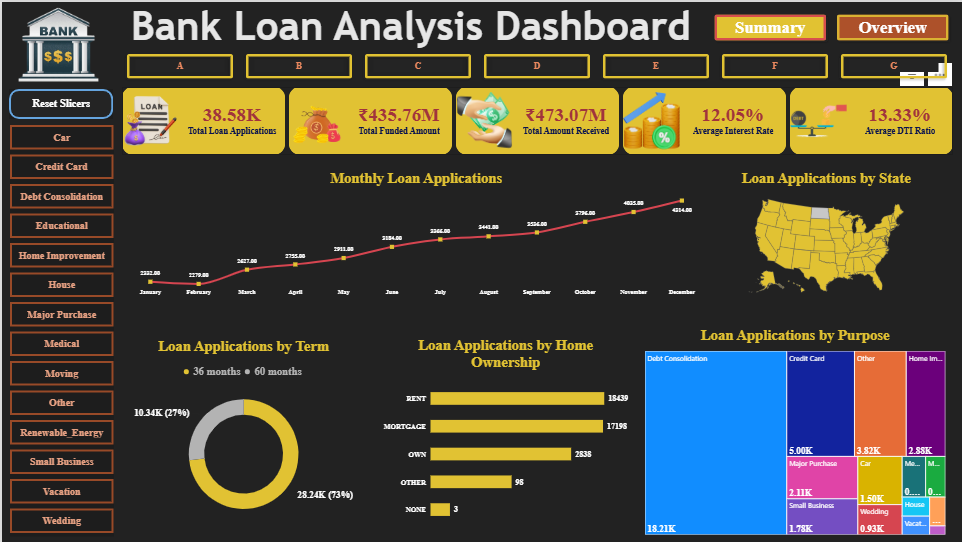
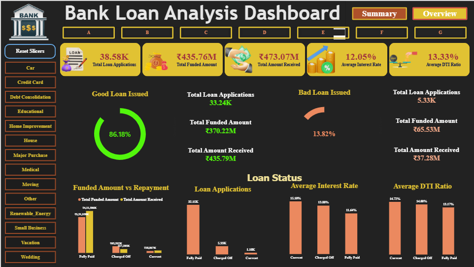

# 🏦 Bank Loan Analytics Dashboard
An interactive Power BI dashboard providing dynamic insights into lending operations, loan portfolio performance, borrower risk profile, and financial health evaluation (Good Loans vs. Bad Loans).
---
## 📊 Dashboard Views & Previews
### 1. Overview View

### 2. Summary View

---
## 🔑 Key Performance Indicators (KPIs)
* **Total Loan Applications:** 38.58K
* **Total Funded Amount:** ₹435.76M
* **Total Amount Received:** ₹473.07M
* **Average Interest Rate:** 12.05%
* **Average DTI (Debt-To-Income) Ratio:** 13.33%
---
## 📈 Key Insights & Portfolio Performance
### 🟢 Good Loans vs. 🔴 Bad Loans
* **Good Loans Issued:** **86.18%** of total applications (33.24K applications, ₹370.22M funded, ₹435.79M received).
* **Bad Loans Issued:** **13.82%** of total applications (5.33K applications, ₹65.53M funded, ₹37.28M received).
### 📊 Portfolio Distribution Insights
* **Term Preference:** 36-Month loans dominate the portfolio at **73%** (28.24K), while 60-Month loans account for **27%** (10.34K).
* **Primary Loan Purpose:** **Debt Consolidation** represents the largest loan category (18.21K applications), followed by **Credit Card** (5.00K) and **Home Improvement** (2.88K).
* **Homeownership Breakdown:** Borrowers residing in **Rent** (18,439) and **Mortgage** (17,198) make up the vast majority of applicants.
---
## 🛠️ Tools & Power BI Techniques Used
* **Business Intelligence:** Microsoft Power BI Desktop
* **Data Modeling:** DAX measures for KPI metrics and dynamic calculations
* **Visualizations:** Donut Charts, Treemaps, Line Area Trends, Horizontal Bar Charts, US Map Visuals
* **Interactivity:** Custom Category Slicers, Loan Grade Buttons (A to G), and Navigation Toggle Buttons (**Summary** / **Overview**)
---
## 🚀 How to View the Project
1. Download or clone this repository:
   ```bash
   git clone [https://github.com/svvdainsights-gif/bank-loan-analytics-powerbi-dashboard.git](https://github.com/svvdainsights-gif/bank-loan-analytics-powerbi-dashboard.git)
